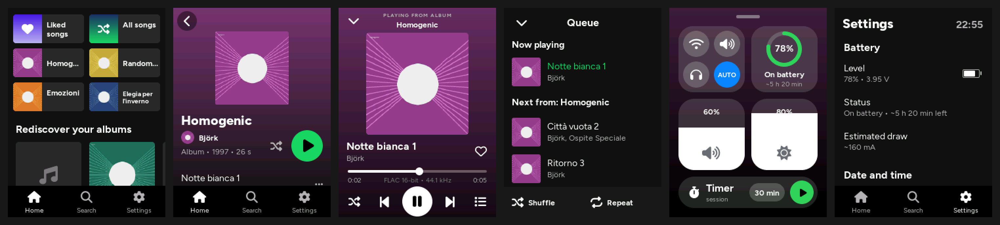

# onda · lettore FLAC per Freenove ESP32-S3 Display (FNK0104B)

Lettore di file **FLAC** dalla microSD integrata, con uscita sullo **speaker integrato**
oppure sulle **cuffie** tramite un DAC **PCM5102** (I2S). Quando inserisci il jack delle cuffie
l'uscita passa da sola alle cuffie; quando lo togli torna allo speaker (e la musica va in pausa,
come sul telefono). Interfaccia touch in stile Spotify, scritta con LVGL 9.5 (inclusa nel progetto).



## Funzioni

- **Home**: scorciatoie recenti, "I più ascoltati", "Riscopri i tuoi album", artisti, generi
- **Cerca**: ricerca istantanea (senza accenti: "bjork" trova "Björk") e sotto la libreria con filtri
  Playlist / Album / Artisti / Generi e ordinamento recenti / alfabetico
- **Impostazioni** come terza scheda della barra in basso (batteria, audio, schermo, Wi-Fi, libreria)
- Pagine **album**, **artista** (Popolari + Discografia), **playlist** `.m3u`, **Brani che ti piacciono**
- **In riproduzione**: copertina, gradiente col colore dell'album, seek, casuale, coda,
  swipe sinistra/destra per cambiare brano, giù per chiudere, su per la coda, formato (es. *FLAC 24 bit • 96 kHz*)
- **Coda** con Casuale e Ripeti (tutto / brano), "Aggiungi in coda", menu del brano (Mi piace, Vai all'album/artista)
- **Gesto indietro** come su Android: trascina dal bordo sinistro verso l'interno
- **Centro di controllo** come su iPhone: scorri su dal bordo in basso (vedi sotto)
- **Trasferimento file via Wi-Fi** dal browser (vedi sotto)
- **Batteria**: percentuale e stato di ricarica nel centro di controllo, avvisi al 10% e 5%,
  standby automatico quando è esaurita (vedi sotto)
- **Tasto BOOT come tasto di accensione**: schermo spento con la musica che continua (es. in
  tasca), play/pausa, spegnimento completo; schermo che si spegne da solo (vedi sotto)
- **Uscita audio** (Automatico / Altoparlante / Cuffie) con volume separato per ciascuna uscita
- Mini player sempre visibile, riprende brano e posizione (salvata in pausa) all'accensione
- FLAC 8–32 bit, 8–96 kHz; i file a 176.4/192 kHz vengono decimati a 88.2/96 kHz
- Copertine JPEG incorporate nel FLAC o `cover.jpg` / `folder.jpg` / `front.jpg` nella cartella

## Hardware

| Funzione | Pin ESP32-S3 | Note |
|---|---|---|
| LCD ILI9341 (SPI) | SCK 12, MOSI 11, MISO 13, CS 10, DC 46, BL 45 | già sulla scheda |
| Touch FT6336U | I2C SDA 16, SCL 15, RST 18, INT 17 | già sulla scheda |
| microSD (SDMMC 4 bit) | CLK 38, CMD 40, D0 39, D1 41, D2 48, D3 47 | già sulla scheda |
| Codec ES8311 → ampli SC8002B | MCLK 4, BCLK 5, WS 7, DOUT 8; ampli EN = IO1 (attivo basso) | già sulla scheda |
| **PCM5102 BCK** | **IO21** | header P3 "Expanded IO" |
| **PCM5102 DIN** | **IO14** | header P3 |
| **PCM5102 LCK** | **IO3** | header P3 |
| **Rilevamento cuffie** | **IO2** | header P3 |
| Batteria (partitore 200k/200k) | IO9 | già sulla scheda, LiPo 3,7 V sul connettore BAT |

### Collegare il PCM5102

```
 Freenove P3 (Expanded IO)          Modulo PCM5102 (GY-PCM5102)
   IO21  ─────────────────────────── BCK
   IO14  ─────────────────────────── DIN
   IO3   ─────────────────────────── LCK
 Freenove P4 (I2C)  3V3 ──────────── VIN
                    GND ──────────── GND, SCK (SCK a massa = PLL interno)
```

Sul retro del modulo i ponticelli devono essere: **FLT = L, DEMP = L, XSMT = H, FMT = L**
(è la configurazione di fabbrica della maggior parte dei moduli; se non senti nulla controlla XSMT).

Il segnale I2S è lo stesso che va all'ES8311: il firmware lo **duplica** sui pin 21/14/3 tramite la
GPIO matrix dell'ESP32-S3, quindi il cambio di uscita è istantaneo, senza riconfigurare nulla. Quando
sono attive le cuffie l'ampli dello speaker viene spento e il DAC dell'ES8311 messo in muto;
quando è attivo lo speaker i pin del PCM5102 vengono staccati dall'I2S e il modulo va in standby.

### Rilevamento automatico delle cuffie

Il jack del modulo PCM5102 "viola" **non ha un contatto di rilevamento**, quindi serve un jack da
3.5 mm con contatto *switch/detect* (es. PJ-307, PJ-320D a 5 pin, o una breakout "audio jack with
switch"):

- uscite L / R / GND del PCM5102 → L / R / GND del nuovo jack
- contatto **detect** del jack → **IO2**, l'altro capo dell'interruttore → **GND**

Con le impostazioni predefinite "cuffie inserite" = IO2 a GND. Se il tuo jack funziona al contrario
attiva **Impostazioni → Inverti rilevamento cuffie** (oppure cambia `HP_DETECT_PLUGGED` in
`src/config.h`). Senza contatto di rilevamento metti `HP_DETECT_PIN -1`: sceglierai l'uscita a mano
dal selettore dispositivo (icona altoparlante/cuffie nel mini player).

## Compilazione (Arduino IDE)

1. Core **esp32 di Espressif 3.x** (testato con **3.2.0**, quello indicato nel tutorial Freenove).
2. Nessuna libreria da installare: **LVGL 9.5** è dentro lo sketch (`src/lvgl`, configurazione
   in `src/lv_conf.h`). Se hai già una LVGL 8 installata nell'IDE non dà fastidio, non viene usata.
   TFT_eSPI e FT6336U **non** servono: display e touch sono gestiti direttamente dallo sketch.
3. Apri `FlacPlayer/FlacPlayer.ino` e imposta in *Strumenti*:
   - Scheda: **ESP32S3 Dev Module**
   - PSRAM: **OPI PSRAM**
   - Partition Scheme: **Huge APP (3MB No OTA/1MB SPIFFS)**
   - USB CDC On Boot: **Enabled**
4. Carica. Il firmware occupa circa 1,7 MB (con il Wi-Fi).

La prima compilazione dura qualche minuto in più (compila anche LVGL); le successive sono veloci.
La versione precedente con LVGL 8.4 esterna è nel branch `lvgl8`.

## La scheda microSD

- FAT32 (o exFAT), cartelle libere, ad esempio `Musica/Artista/Album/01 - Titolo.flac`
- Tag Vorbis letti: TITLE, ARTIST, ALBUM, ALBUMARTIST, TRACKNUMBER, DISCNUMBER, DATE, GENRE
- Playlist: file `.m3u` / `.m3u8` ovunque sulla scheda (percorsi relativi o assoluti)
- Alla prima accensione la libreria viene indicizzata (barra di avanzamento); le volte successive
  parte in un attimo. Se aggiungi brani, all'avvio vengono letti solo i file nuovi; puoi anche
  usare **Impostazioni → Aggiorna libreria**.
- Cache, preferiti e statistiche stanno in `/.onda` (puoi cancellarla: verrà ricreata).

## Trasferimento file via Wi-Fi

**Impostazioni → Trasferimento file**: il lettore accende il Wi-Fi e apre una pagina web per
gestire la microSD dal browser (computer o telefono):

- carica file o intere cartelle (anche trascinandole nella pagina), con avanzamento e velocità
- crea cartelle, rinomina, sposta, elimina, scarica; i file nascosti (es. `/.onda`) solo su richiesta
- **Aggiorna libreria** (nella pagina) oppure **indietro** sul lettore: il Wi-Fi si spegne,
  vengono letti solo i file nuovi e la riproduzione riprende da dove eri

Rete: dalla schermata del lettore scegli la **rete di casa** (password con la tastiera a schermo);
poi la pagina è su `http://onda.local` o sull'IP mostrato, con il codice QR. Senza rete salvata
(o se non è raggiungibile) il lettore crea un **hotspot** `onda-XXXX`: inquadra il codice QR col
telefono per collegarti, poi apri `http://192.168.4.1`.

Durante il trasferimento la musica è in pausa: Wi-Fi e uscita audio non stanno insieme nella RAM
interna del chip. La velocità tipica è di circa 0,5-1 MB/s.

La pagina web è in `tools/web/index.html`; dopo averla modificata rigenera
`src/net/web_index.h` con `python3 tools/web/embed.py`.

## Centro di controllo

Scorri il dito verso l'alto partendo dal **bordo in basso** dello schermo (da qualsiasi
schermata, anche In riproduzione): il pannello segue il dito, come su iPhone. Si chiude
trascinando giù (o toccando) la maniglia in alto, scorrendo giù, toccando uno spazio vuoto o
col gesto indietro.

- **Wi-Fi**: apre il trasferimento file (blu quando è attivo)
- **Altoparlante / Cuffie / AUTO**: sceglie l'uscita audio (AUTO = cuffie quando le inserisci)
- **Batteria**: anello con la percentuale, autonomia stimata (a batteria) o tempo alla carica
  completa (in carica)
- **Volume** e **Luminosità**: trascina il dito su o giù partendo da un punto qualsiasi del
  riquadro; il volume è quello dell'uscita in uso

## Batteria

Con una LiPo 3,7 V sul connettore **BAT** (testato con 1100 mAh) livello e stato di ricarica
sono nel centro di controllo. In **Impostazioni → Batteria** ci sono anche tensione e tempo
stimato alla carica completa.

- **Ricarica**: il caricatore della scheda (TP4054, circa 300 mA) carica una 1100 mAh in circa
  4 ore; l'ultima parte (dal 90% circa) è più lenta.
- **Come capisce se è in carica**: la scheda non collega al chip né il LED di carica né la
  presenza del cavo, quindi lo stato si ricava dalla tensione (sale di colpo quando colleghi il
  cavo, scende quando lo stacchi). Collegato a un computer lo riconosce subito; con un
  alimentatore può servire qualche secondo, e se accendi il lettore col cavo già collegato
  qualche minuto. "Carica completa" arriva quando la tensione si stabilizza a 4,2 V.
- **Batteria scarica**: avviso al 10% e al 5%. Sotto 3,3 V il lettore salva il punto in cui eri,
  mostra *Batteria scarica* e va in standby; dopo aver collegato il caricatore si riaccende
  toccando lo schermo, col tasto BOOT o con RESET. Se la batteria è ancora troppo scarica l'avviso ricompare.
- **Autonomia**: il consumo viene stimato da cosa è acceso (luminosità, altoparlante o cuffie e
  volume, riproduzione, Wi-Fi), quindi la stima cambia subito se alzi il volume o la luminosità.
  I valori di partenza sono tipici di questa scheda; durante la scarica il lettore confronta il
  consumo stimato con quanto cala davvero la batteria e si corregge da solo (dopo una ventina di
  minuti a batteria la stima è più affidabile; la correzione resta salvata). In Impostazioni →
  Batteria c'è anche il consumo stimato in mA.
- La percentuale è una stima dalla curva tipica di una LiPo: durante l'ascolto può oscillare di
  qualche punto. Se la tensione mostrata in Impostazioni differisce da quella misurata col tester,
  correggila con `BAT_OFFSET_MV` in `src/config.h`.
- Da spento (deep sleep) la scheda consuma ancora un po' (regolatore, display, touch, DAC
  esterno): per lunghi periodi di inutilizzo scollega la batteria.

## Tasto BOOT e risparmio energetico

Il tasto **BOOT** della scheda (IO0) fa da tasto di accensione, così non serve nessun pin in più:

| Tasto BOOT | Cosa fa |
|---|---|
| 1 clic | spegne o riaccende lo schermo; la musica continua |
| 2 clic | play / pausa (anche a schermo spento, ad esempio in tasca) |
| tenuto premuto ~1 s | spegnimento completo (deep sleep); si riaccende premendolo di nuovo |

- **Schermo che si spegne da solo** dopo 30 secondi senza toccarlo (Impostazioni → Schermo:
  15 s, 30 s, 1 min, 2 min, 5 min o Mai). Se si è spento da solo un tocco lo riaccende
  (disattivabile con *Riattiva toccando*); se l'hai spento col tasto il touch resta bloccato e
  si riaccende solo col tasto, così in tasca non parte nulla per sbaglio. Il tocco che riaccende
  lo schermo non arriva all'interfaccia. Durante il trasferimento file lo schermo resta acceso.
- **A schermo spento** il display va in sleep (retroilluminazione spenta), LVGL non ridisegna
  nulla e il processore scende a 80 MHz (160 MHz per i file oltre i 48 kHz; `SCREEN_OFF_CPU_MHZ`
  in `src/config.h`, 0 = sempre a 240 MHz). La musica e il resto continuano normalmente.
- **Spegnimento automatico**: in pausa, a batteria e senza toccarlo per 10 minuti il lettore
  salva il punto in cui eri e si spegne (Impostazioni → Tasto BOOT: 5, 10, 30, 60 min o Mai).
  Col cavo collegato non si spegne. C'è anche *Spegni ora*.
- Alla riaccensione riparte da dove eri (brano e posizione), senza l'attesa iniziale.

## Struttura del progetto

```
FlacPlayer/
  FlacPlayer.ino          setup/loop, montaggio SD, task di scansione
  src/config.h            pin e opzioni
  src/hal/display.*       ILI9341 via esp_lcd (SPI+DMA), touch FT6336U, driver LVGL
  src/hal/battery.*       lettura della batteria, stima di percentuale e stato di ricarica
  src/power.*             tasto BOOT, schermo spento, spegnimento (deep sleep), frequenza CPU
  src/hal/edge_swipe.*    gesti dai bordi: "indietro" (sinistra) e centro di controllo (in basso)
  src/audio/es8311.*      codec dello speaker
  src/audio/audio_out.*   I2S 32 bit, duplicazione sul PCM5102, rilevamento cuffie, volumi
  src/audio/player.*      task di decodifica (dr_flac), coda, shuffle/repeat, rampe anti-click
  src/lib/                scansione SD, tag FLAC, indice, ricerca, preferiti, copertine (TJpgDec)
  src/ui/                 pagine LVGL (Home, Cerca, Impostazioni, Album, Artista, In riproduzione,
                          centro di controllo...)
  src/net/                trasferimento file: Wi-Fi, hotspot, mDNS, server HTTP e pagina web
  src/fonts/              font generati (Figtree + icone Font Awesome)
  src/lvgl/               LVGL 9.5.0 (solo i file necessari, licenza MIT)
  src/lv_conf.h           configurazione LVGL
tools/gen_fonts.sh        rigenera i font con lv_font_conv
tools/web/                pagina web del trasferimento file (+ embed.py)
```

## Limiti noti

- Copertine PNG o JPEG progressive non vengono mostrate (compare il segnaposto).
- Caratteri non latini (cirillico, CJK...) nei tag non hanno glifi nel font.
- Tra brani con frequenze di campionamento diverse c'è una brevissima pausa (riconfigurazione I2S).

## Licenze di terze parti

dr_flac (pubblico dominio / MIT-0), TJpgDec (© ChaN, licenza libera), font Figtree (SIL OFL 1.1),
icone Font Awesome Free 6 (SIL OFL 1.1 / CC BY 4.0). L'interfaccia è *ispirata* a Spotify per uso
personale: nomi, logo e marchi Spotify non sono inclusi.
